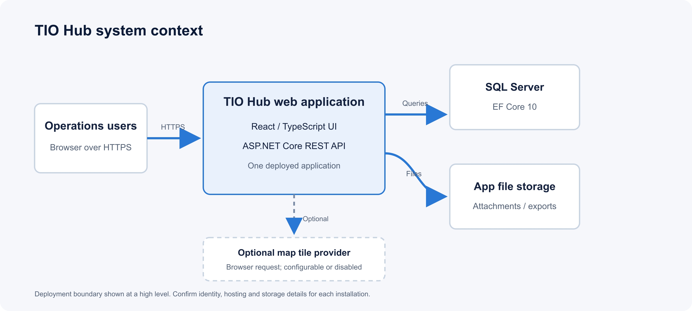
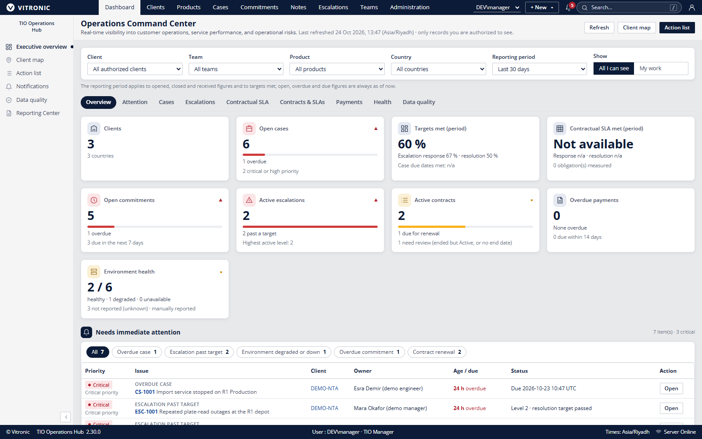

# TIO Operations Hub System Design Document

| Control field | Controlled value |
|---|---|
| Document ID | TIO-ARC-001 |
| Version / status | 2.2 / Advanced service-operations architecture - review pending |
| Classification | Internal engineering and operations |
| Owner / approver | Engineering/architecture owner (proposed) / Security, operations and Product (pending) |
| Issue date / review | 24 October 2026 / On material architecture, security, deployment or data-model change |
| Source baseline | Repository working tree reviewed 24 October 2026; release notes identify 2.30.0 and in-progress work may be newer |
| Supersedes | Initial System Design Document dated 24 October 2026 |

## 1. Executive summary

TIO Operations Hub is a customer-managed web application for recording and reviewing operational context across clients, projects, environments, products, infrastructure, cases, commitments, contracts, teams and reports. It is implemented as an ASP.NET Core 10 modular monolith with a React/TypeScript client and SQL Server persistence. The supported production shape documented by the repository is one IIS-hosted application instance connected to one SQL Server database, plus configured file storage for attachments and generated exports.

The design prioritizes a single deployable system, relational records, server-side authorization and a controlled DBA-led schema release. It does not depend on service-to-service messaging. The product does not automatically discover or monitor client infrastructure, synchronize Jira, retrieve secrets from vaults, send email, provide customer-facing self-service, or settle financial penalties. Condition, inventory and operational status are user-maintained records. Any proposed integration, hosted multi-tenant model, high availability, public holiday calculation or scale-out must go through a separate architecture decision and security/operability review.

This SDD is based on repository evidence rather than an independent inspection of a production environment. The working tree may contain changes beyond release 2.30.0. Before approving a deployment or external design representation, establish the exact source commit, artifact version, migration set, configuration and evidence baseline.

## 2. Purpose, audience, and scope

This design provides engineering, product, security, deployment and operations reviewers with a coherent system boundary, component model, data/security behavior, runtime topology, key risks and open decisions. It is not a threat model, production as-built, privacy impact assessment, capacity plan, service-level agreement or assurance report.

**In scope:** application components and modules, request/data paths, SQL and file-backed storage, identity and authorization, reporting workers, release/deployment, recovery assumptions and documented external dependencies.

**Out of scope:** organization-specific network diagrams, cloud/vendor commitments, production load measurements, detailed per-table schema, exhaustive API contract, final operational procedures, formal threat analysis and legal data-processing roles. The authoritative source for these items is linked in Section 16.

## 3. System context and trust boundaries



The browser loads the SPA and calls the same-origin `/api/v1` service. IIS hosts the ASP.NET Core application and serves built frontend assets. The API authenticates the request, resolves effective user context, applies endpoint/workflow authorization and scope-aware queries, then accesses SQL Server through EF Core. Attachment and export bytes may be stored outside SQL Server in configured directories; database metadata associates files with records and users.

The application does not initiate calls to Jira, client systems, secrets vaults or outbound mail services in the documented design. Jira identifiers are manual references. Optional map tiles are requested directly by the user's browser from the configured HTTPS tile service; public service use, attribution and privacy implications are operator decisions. Bundled geographic data supports the map when tile access is unavailable or disabled.

**Trust boundaries:** (1) user's browser and local device; (2) IIS/ASP.NET application process; (3) SQL Server; (4) attachment/export/log/backup file stores; (5) organization identity provider/IIS authentication; (6) optional browser-to-tile-provider request. Each boundary requires deployment-specific authentication, network, ACL, logging and retention controls.

## 4. Functional capabilities and domain scope

| Domain | Responsibilities | Important limit |
|---|---|---|
| Access and administration | Users, roles, mappings, resource/action grants, settings, audit and supported archive/restore | Administrator status alone does not imply business-record access |
| Client context | Clients, projects, optional regions, contacts, responsibility boundaries, contextual organization relationships | Organization graph is not an authorization boundary |
| Technical context | Environments, reported condition, catalog/version/installations, assets/components/storage, network/firewall and dependencies | No automatic discovery or continuous monitoring |
| Work management | Cases, affected records, impact, state/history, waiting periods, manual Jira references, commitments and escalations | Jira state is not synchronized |
| Contracts and service measures | Contract terms, renewal, same-client case association, priority-specific SLA snapshots, response/resolution evaluation and monthly indicative penalty assessment | Penalty records do not issue money/credits; no accounting settlement; public holidays are not modeled |
| Teams and quality | Coverage, handovers, review policies, data-quality evaluation and in-app notifications | Quality results depend on configured rules and record freshness |
| Reporting | Executive overview, action list, search, report catalog, preview, exports, schedules, history and private presets | CSV/Excel are documented; formatted PDF and email delivery are not |

Feature availability is release- and configuration-dependent. The implementation baseline and requirement coverage should be checked before representing any item as generally available.

## 5. Logical architecture

The backend is a modular monolith: one ASP.NET Core process, one deployable application, logical business modules and one shared EF Core `HubDbContext`. Modules own endpoints, entities and workflow rules but can share context for transactional reads and updates. There are no independent service deployments or message bus in the evidenced architecture.

```text
Browser: React 18 / TypeScript SPA
          | same origin, HTTPS, /api/v1
IIS / ASP.NET Core 10 host
  Shared validation, errors, date/time, paging, file/report services
  Identity resolution and authorization context
  Clients | Environment | Catalogue | Inventory | Network/Firewall
  Cases | Commitments | Contracts | Escalations | Teams | Quality
  Reporting | Notifications | Attachments/Notes | Administration
          | EF Core 10 / SQL Server provider
SQL Server: business records, access control, audit, notifications, reporting metadata
          | record/file identifiers and ownership
Configured file storage: attachments, exports, logs and deployment data
```

The React application uses Vite, TanStack Query and React Router and is built into the API's `wwwroot`. The frontend provides navigation and interaction; it is not a security boundary. Every protected operation and file download must enforce access in the API.

## 6. Runtime components and deployment topology

| Runtime component | Function | Operational owner to confirm |
|---|---|---|
| IIS / Windows Server | HTTPS binding, hosting integration and configured authentication forwarding | Infrastructure/identity operator |
| ASP.NET Core 10 | API, SPA hosting, validation, authorization, modules, health checks and hosted jobs | Application operations |
| SQL Server 2019+ | Relational system of record and migration history | DBA |
| File system or approved share | Attachment, export, logs and app data paths | Application/backup operations |
| User browser | SPA execution and optional map tile requests | Customer endpoint/identity owners |
| Optional tile endpoint | Browser-loaded map tiles with attribution | Network/map provider owner |

Production documentation targets Windows Server 2019 or later, IIS 10, ASP.NET Core Hosting Bundle 10.0.x and SQL Server 2019+ (compatibility level 150+). The application uses its Windows service/app-pool identity for SQL access in the documented deployment pattern. Exact auth mode, identity, TLS, SQL grants, storage paths, tile source and backup policy are installation-specific.

The normal release process builds the frontend and API as one matched package. A DBA reviews/applies the idempotent SQL schema script before matching application files. Production `Database__ApplyMigrationsOnStartup` stays false; readiness checks required migration history and fails closed instead of applying migrations. Development authentication and seeded development records are prohibited in Production.

## 7. Request, authorization, and data flow

1. The user reaches the HTTPS IIS site and authenticates through the configured Forms or Windows mode.
2. The application resolves the authenticated principal to an active TIO Hub user, groups/mappings where enabled, assigned roles, scope, grants and current session context.
3. Endpoint and workflow checks authorize the requested resource/action. Query filters and domain checks constrain records; archive state is handled separately from scope. Frontend visibility does not replace these checks.
4. The module validates input and applies the business transition. Shared persistence and audit behavior save structured data/history in SQL Server.
5. The SPA renders permitted records. For files, the API checks ownership/authorization before returning bytes from configured storage. Export generation records its job and uses authorized query results.
6. Events and logs capture operational outcomes subject to logging policy. Request logs avoid query strings because search terms can include client data.

The current decision gives business users broad shared client visibility. Resource/action rights govern operations; the policy must not be marketed as per-client or tenant isolation. Administration alone is not business access. Technical detail, export and audit rights are separately controlled. Access changes invalidate cached permission snapshots as documented by the implementation.

## 8. Data architecture and lifecycle

SQL Server is the system of record for entities, access controls, audit/event history, notifications and reporting metadata. EF Core migrations describe the application model; `database/01-schema.sql` is the production deployment artifact and must be reconciled with migrations. Readiness verifies expected migration entries. No runtime production migration is intended.

Contract-linked cases preserve relevant service-term snapshots so later contract changes do not silently rewrite the case's recorded obligation. Organization relationships belong to a client context and optionally a project; relationships do not confer permission to another client. Deletion and restore workflows require resource/action checks and account for dependent records instead of unrestricted cascading deletion.

Service measurements use the applicable target, support basis, support window/time zone and pause rule copied to the case when a contract is set or priority changes. Case creation starts measurement. First response is explicitly recorded as a customer-facing response at actual send time; internal notes and system events do not qualify. Resolution is the first transition to Pending validation or Closed; a rejected validation clears it, while a later reopen retains the first resolution under the documented policy. Only customer waiting can pause the clock when the contract allows it; vendor and internal waits do not. Public holidays are not modeled. Reporting distinguishes Not applicable, Not measurable, Pending, Met and Breached; missing values are never counted as met. Later contract edits do not rewrite the case snapshot, so contract amendments require explicit operational and financial reconciliation.

Attachments and exports are file-backed. Database metadata, path configuration, application identity ACL, retention and backup must be considered together. Restoring SQL without compatible file data can create records whose files are missing; restoring files without matching database records can leave orphaned content. Logs, backup copies and exports may contain sensitive operational information and require access/retention controls.

## 9. Authentication and authorization model

The application supports configured Forms or Windows Integrated authentication through IIS. Development sign-in is restricted to Development and Testing. Windows group mappings may contribute effective roles and scopes. Forms credentials are managed as hub accounts; session lifetime and lockout settings are configurable. Verify exact defaults against the release configuration before use.

Effective authorization combines authenticated identity, active hub user, roles, resource/action grants and applicable scope. The API enforces permissions on protected operations. Restore/delete paths and dependent record changes require specific rights according to current decisions and code. Export history/download rules restrict downloads to the generating user; scheduled reports are generated separately for each eligible recipient using that recipient's own access as documented.

Before a production rollout, the owner must approve identity mode, MFA/identity-provider controls, bootstrap administrator, group mapping, lockout/session policy, access review cadence, business visibility boundary, export/technical/audit grants and incident handling. These controls must be validated on the exact target installation.

## 10. API and presentation layer

The API is REST under `/api/v1`; runtime OpenAPI is at `/openapi/v1.json` for authorized access. Conventions, DTOs, error shapes and current endpoints are maintained in `docs/API.md` and `docs/openapi-v1.json`. The React SPA uses same-origin requests and shared design/navigation components. Static app entry files are handled for freshness while content-hashed assets may be cached.

Security headers, HTTPS redirection and HSTS behavior depend on environment and configuration. Validate IIS forwarding and proxy behavior, cookie settings, CORS/CSP, host allowlists and external links at deployment. The API must independently validate authorization, request fields, time zones, host allowlists, export columns, report filters and workflow transitions.

## 11. Background processing and reporting

Hosted services evaluate data-quality rules, refresh notification state, sweep SLA obligations and run due report schedules/expiry work. Intervals are configuration-driven; where supported, zero disables recurring work. These jobs run in-process. Multiple application instances may duplicate work or diverge in cache/file behavior unless a later design adds coordination and is verified.

Reporting definitions are centralized and reused for catalog, filters, previews, exports and schedules. Filters are server-validated, queries are access-aware, rows are bounded (documented default maximum 100,000), export files have configurable storage/retention (documented default 14 days), and downloads are authorized. CSV and Excel are supported in the documented baseline. Schedules create in-hub notifications, not emails. Confirm exact report definitions, calculation denominator, time zone, failure handling and retention before operating a business-critical report.

The service operations management model and local control cadence are defined in [TIO-OPS-003](portfolio/service-management-playbook.md). That playbook is a proposed procedure, not an application control attestation. Daily at-risk/overdue review, monthly contract-linked SLA review and finance reconciliation depend on named people and local policy. TIO Hub does not provide a general ledger or automated Jira synchronization in the documented baseline.

## 12. Security, privacy, and threat considerations

Primary assets include client/contact data, support cases, technical inventory/network details, contracts, identity/grants, audit records, attachments, exports, setup credentials, database backups and logs. Relevant threats include compromised user/admin accounts, overbroad grants, cross-scope query defects, unauthorized exports/downloads, malicious uploads, insecure IIS/TLS, SQL overprivilege, path/ACL exposure, stale backups, secret leakage, dependency compromise, tile-provider requests and scheduler duplication.

Baseline controls described in source include server-side authorization, role/action checks, separate access for technical/export/audit behavior, secure cookie/request protections, input/path/host validation, append-only audit guidance, least-privilege SQL permissions, application-controlled file checks, health/readiness checks, release package validation and no production startup migrations. Confirm exact implementation and settings with a release review and test evidence; do not infer a completed threat model or independent assessment.

Before production, complete threat modeling; configuration and penetration testing; IIS/TLS/auth validation; SQL and file ACL review; upload/export abuse cases; secret handling; log/backup protection; privacy/data-flow review; subprocessor/tile review; incident response; vulnerability management; and evidence retention. No SOC 2/ISO certification or external audit report was present in the reviewed material.

## 13. Reliability, recovery, and operational model

The operations guide defines release, DBA schema application, IIS deployment, health checks, backup, restore and rollback. Startup readiness validates database/schema state before initialization. Health endpoints are `/api/health/live` and `/api/health/ready`; confirm access/monitoring behavior and alert policy locally. Worker failures are logged and generally retried on later intervals, but a retry is not equivalent to durable queueing.

Operators must set service hours, alert thresholds, log retention, backup frequency, attachment/export backup scope, RPO/RTO, recovery tests, capacity and maintenance windows. None are universal product guarantees. Validate a restore in an isolated environment, including SQL and required file content, before switching production.

## 14. Quality attributes and constraints

| Attribute | Design approach | Constraint or acceptance evidence needed |
|---|---|---|
| Maintainability | Domain modules within one deployable API and shared context | Keep module ownership explicit; avoid unintended coupling |
| Access control | API-side roles, scopes and resource/action checks | Negative tests and target configuration review; broad visibility is not tenant isolation |
| Auditability | Change events, history and export activity | Infrastructure monitoring, retention and independent review require operator controls |
| Compatibility | Versioned API, EF migrations, matched app/schema package | Upgrade/rollback tests and schema coverage before each release |
| Portability | Windows/IIS and SQL Server production target | Alternative hosts require separate support/validation |
| Availability/scale | One application instance is the documented support shape | No availability/capacity SLO; worker/cache/file coordination needed for scale-out |
| Data freshness | Human-maintained records and reported condition | Review cadence and source ownership required; no live polling |
| Reporting | Validated server filters, authorized queries, bounded CSV/XLSX | PDF export and email delivery not documented; calculation tests required |
| Recovery | Database plus file-backed storage restore | RPO/RTO and production-like drill remain owner decisions |

No validated production user-count, throughput, latency, database-size or recovery-time measurement is established by this design.

## 15. Key decisions, open points, and risks

### Decisions reflected in current design

- Modular monolith and same-origin deployment.
- SQL Server and EF Core migrations; production schema is DBA-applied.
- Broad shared business visibility with separate action grants; not customer tenant isolation.
- Contextual organization graph does not grant access.
- SLA and penalty calculations are recorded operational assessments; no automatic financial settlement.
- In-process workers and local/configured storage; one application instance remains the supported baseline.

### Owner decisions before a production commitment

| Decision | Required owner | Why it matters |
|---|---|---|
| Identity provider, authentication mode, MFA and group mapping | Security/identity | Account lifecycle, assurance and access behavior |
| Client confidentiality and access boundary | Product/security/customer owner | Determines whether current shared visibility is acceptable |
| Hosting, network, capacity and availability target | Infrastructure/service owner | Availability, scale and support scope |
| Database/file retention, backup, RPO/RTO and restore cadence | DBA/service owner | Recovery and contractual obligations |
| Tile provider, attribution and browser privacy | Network/privacy owner | External requests and terms |
| Data controller/processor, jurisdictions and sub-processors | Legal/privacy | Lawful processing and customer notice |
| Support hours, incident contacts and escalation | Service owner | Operational response responsibility |
| Assurance target and disclosure policy | Security/legal/executive | Prevents unsupported certification claims |

### Material risks

- Incorrect auth/IIS/SQL/file configuration can expose data or block valid access.
- Broad visibility may not meet customer confidentiality expectations.
- Database/file restore mismatch can break attachment/export retrieval.
- In-process jobs, caches and file storage do not support unreviewed horizontal scaling.
- User-maintained condition/inventory may be stale or inaccurate.
- Contract terms, time zones, calendar behavior and indicative penalties need business review.
- Working tree and release notes may not align; confirm exact release before deployment.
- Browser map tile service availability/privacy are outside the application boundary.

## 16. Verification and decision gates

Before release approval: establish source commit and package hash; compare migrations with generated SQL; execute appropriate .NET, frontend and browser tests; review security and permission negative paths; validate build/package contents; install against isolated SQL and target-like configuration; verify health, auth, key workflows and reporting; test backup/restore and rollback; record owner approvals. For production, add customer UAT, environment-specific security review, monitoring, capacity, support, privacy and recovery acceptance. This document does not claim those gates have been completed.

## 17. Source references

- [Project overview and technology](../README.md)
- [Decisions and assumptions](DECISIONS.md), including current authorization, organization, SLA, penalty and Reporting Center decisions
- [Design rules](DESIGN-RULES.md)
- [Implementation plan](IMPLEMENTATION-PLAN.md)
- [Requirements coverage](REQUIREMENTS-COVERAGE.md)
- [API guide](API.md) and [OpenAPI document](openapi-v1.json)
- [Operations](OPERATIONS.md) and [deployment guide](DEPLOYMENT-GUIDE.md)
- [Release notes 2.30.0](RELEASE-NOTES-2.30.0.md) and [dated test results](TEST-RESULTS.md)
- [Organization hierarchy design](ORGANIZATION-HIERARCHY.md) and stage/decision notes
- Source areas: `src/TioHub.Api/Program.cs`, module registration, security, `HubDbContext`, migrations, `src/web`, `database/01-schema.sql`

## 18. Contract, SLA and financial control architecture

### 18.1 Domain boundary and authority

| Domain object / evidence | System role | Authority and lifecycle constraint |
|---|---|---|
| Contract record | Operational index of terms, status, dates, client and renewal context | Executed agreement and approved repository remain authoritative; TIO Hub is not a signature or legal document-management workflow |
| Contract-case association | Associates one eligible client case with a same-client contract and records change reason/history | Historical cases are not automatically associated; authorized users verify eligibility and corrections |
| Case SLA snapshot | Captures priority-specific target, measurement basis, support calendar/timezone and pause rule at association/priority change | Later contract amendments do not overwrite past case snapshots; owners approve interpretation and exceptions |
| Case events | Provides recorded start, qualifying response, status transition and customer-wait interval evidence | First response must be explicitly customer-facing at actual send time; internal notes/system events do not qualify |
| SLA report | Computes population, rates and state buckets from the server-side catalog | Filters and access scope are validated; export is an analysis artifact, not signed service or finance evidence |
| Indicative financial assessment | Supports potential penalty review using recorded case/contract terms and cap rules | Finance independently reconciles clause, cohort, evidence and approval; no ledger, invoice, credit issuance or settlement |

### 18.2 Measurement and reporting data path

```text
Executed contract (authoritative repository)
        | approved mapping / human verification
TIO contract record ---- renewal / term reference
        | eligible same-client association
Client case + priority snapshot + event history + waiting intervals
        | common CaseSla / SlaClock calculation and scheduled evaluation
SLA status and deadlines -> report catalog -> access-filtered preview/export
        | sample reconciliation and exception handling
Service review decision -> corrective action / dispute / controlled finance workpaper
```

The application centralizes calculation on case changes, scheduled evaluation and backfill for cases not yet evaluated. A deadline can be evaluated as breached before a periodic sweep persists its updated stored state. Reporting relies on current query logic and server filters. Record report data time, timezone, filters, population and export identifier with a management pack. The pipeline provides operational traceability, not an immutable contract repository or accounting subledger.

### 18.3 SLA state interpretation and exceptions

Measurement states are Not applicable, Not measurable, Pending, Met and Breached. Not applicable covers internal/cancelled/no-contract cases. Not measurable covers missing target, unknown basis, incomplete support calendar and documented tracking-history limits. Pending obligations transition to breached when the deadline passes without a qualifying actual. Met requires a qualifying recorded actual at or before deadline. Missing data is never treated as met. At risk is a report warning for a pending deadline within 24 hours, not a contractual state or probability forecast.

Clock basis is elapsed calendar hours or configured support hours in the contract timezone. Customer waiting pauses only when the contract rule allows it; vendor/internal waits do not. Daylight-saving transitions use the configured zone; overnight support belongs to its starting support day. Public holidays have no modeled calendar in the cited baseline. Reconfirm these rules against the deployed release, governing decision and executed contract before a customer-level determination.

### 18.4 Financial reconciliation interface

A financial review should consume a frozen candidate population and preserve the trace chain: export/job -> case identifier -> association history -> case term snapshot -> qualifying event evidence -> contract clause/version -> term/cap cohort -> independent recomputation -> approver decision -> separate finance transaction reference, if any. Decision A66 states unchanged monetary terms share a cap cohort, genuine monetary amendments retain recorded case terms, and priority changes refresh SLA targets without repricing penalties. The target application does not establish general-ledger, accounts-receivable/payable, tax, invoice, payment, credit-note or settlement functions.

### 18.5 Integration and ITSM boundaries

Cases, commitments, escalations, teams, handovers and manual Jira references are first-party work records. A manual reference does not provide synchronization, delivery guarantees, conflict resolution or identity mapping. Monitoring, alert ingestion, problem/change/release management, major-incident command, customer portal, outbound email and ITSM system-of-record integration require separately approved scope, threat/data-flow review, idempotency and reconciliation design, operational owner and acceptance evidence.

## Appendix A. Illustrative application interface



This direct capture uses fictional development data in a dedicated local database. Displayed figures are not customer results or production telemetry. The header includes reference VITRONIC branding; obtain brand-owner approval or replace it with an approved brand-safe image before external distribution.


Illustrative record counts only. They are not benchmarks, service-performance measurements or evidence of customer outcomes.

## Appendix B. Revision history

| Version | Date | Change | Approval |
|---|---|---|---|
| 1.0 | 24 Oct 2026 | Initial implementation-oriented SDD | Draft |
| 2.0 | 24 Oct 2026 | Rebuilt with trust boundaries, flows, security, operations, decision gates, and controlled status | Architecture/security review pending |
| 2.1 | 24 Oct 2026 | Expanded SLA measurement, contract amendment, finance boundary and ITSM operations design | Architecture/security review pending |
| 2.2 | 24 Oct 2026 | Added service-operations domain authority, measurement data path, SLA exception semantics and finance/ITSM integration controls | Architecture/security review pending |
