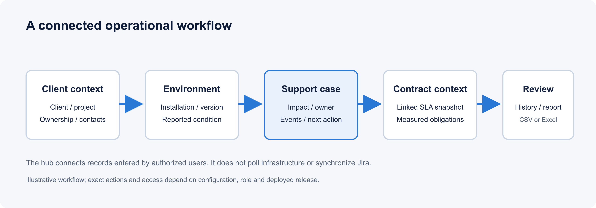
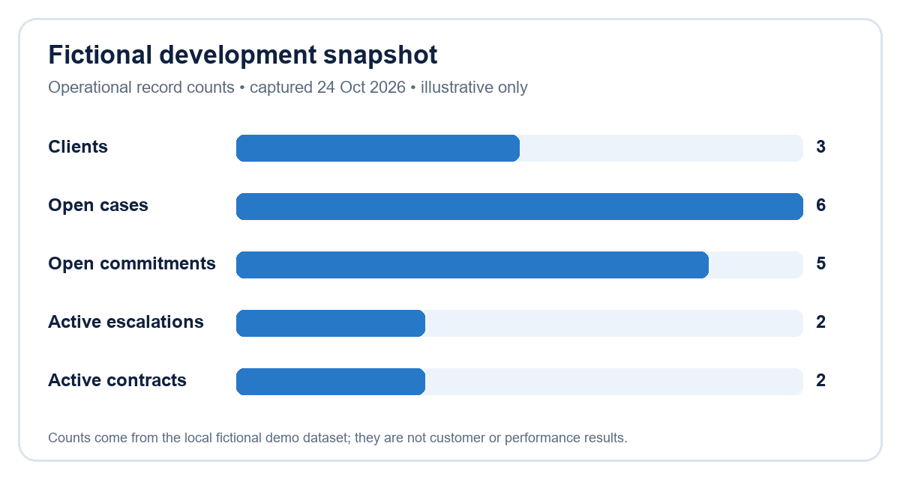

# Product Requirements and Roadmap

| Control field | Controlled value |
|---|---|
| Document ID | TIO-BIZ-001 |
| Version / status | 2.1 / Working draft - approval pending |
| Classification | Internal product planning |
| Owner / approver | Product owner (proposed) / Leadership and delivery owners (pending) |
| Issue date / review | 24 October 2026 / 24 January 2027 or at quarterly planning |
| Source baseline | BRD v1.0 (16 Oct 2026), repository working tree reviewed 24 Oct 2026 |
| Supersedes | Initial portfolio product pack dated 24 October 2026 |

## 1. Product definition

TIO Operations Hub is an internal operational record and workflow application for teams supporting software across client organizations and environments. It brings business context, technical inventory, contractual terms and operational work into a shared interface backed by a customer-managed SQL Server database.

The product helps teams maintain and navigate connected records. It does not automatically discover infrastructure, synchronize Jira, monitor client systems, retrieve secrets, send email, or act as a customer self-service portal. Its value depends on accurate records, clear ownership, suitable authorization, and operating procedures.

## 2. Problem statement and outcomes

Operational teams routinely need to reconstruct which client and environment a request concerns, what is installed, which contractual terms apply, who owns the next step, and whether the information is current. Fragmented registers and handover practices can make that context difficult to review consistently.

The product objective is to provide a shared, permission-controlled place to record that context and connect it to cases, commitments, contracts, team coverage, review and reporting. These are intended product outcomes. No measured time saving, financial return or customer satisfaction result is available in the current evidence set.

## 3. Users and jobs to be done

| Persona | Primary job | Key risks / needs | Candidate success evidence |
|---|---|---|---|
| Operations engineer | Investigate a case and update the next action using client/environment context | Stale inventory, missing owner, unclear impact, unauthorized technical detail | Representative case can be traced from client through affected record to owner and history |
| Operations manager | Review workload, overdue work, coverage and contractual attention | Aggregated counts hide definitions; ownership gaps; unclear escalation policy | Agreed review scenarios reconcile to source records and export filters |
| Service or contract owner | Maintain terms, renewal dates and approved support boundaries | Draft values mistaken for universal SLA; contract revision changes historic case context | Contract-linked case retains the intended term snapshot and reviewer can explain the result |
| Finance reviewer | Reconcile potential service penalties against clause, case evidence, terms cohort and cap | Indicative assessment mistaken for credit or accounting entry | Candidate assessment has independent review and documented disposition |
| ITSM/service manager | Triage, assign, escalate, hand over and review cases and commitments against agreed service controls | Operational work records mistaken for a full ITIL suite, monitoring integration or synchronized service desk | Agreed daily/weekly/monthly work review reconciles to case-level records |
| Technical lead / architect | Review installed versions, dependencies and infrastructure records | Product does not verify live state; technical access is restricted separately | Sample inventory can be reviewed with evidence date, owner and review policy visible |
| Administrator | Configure users, action grants, reference values and operational settings | Admin authority must not imply access to client data or uncontrolled destructive actions | Role/action matrix and audit history pass approved positive and negative scenarios |
| Read-only stakeholder | Understand current operational picture without editing | Metric definitions and scope must be clear | Dashboard and report values reconcile to an agreed snapshot and accessible record set |

Personas are role archetypes, not customer research findings. Validate them through interviews and pilot observation before using them as market evidence.

## 4. Product scope

### In scope

- Client, optional region, project, contact, responsibility and contextual organization records.
- Environments, reported condition, product catalogue, versions, installations, assets, components, storage and documented network/dependency context.
- Cases, affected records, impact, ownership, history, waiting periods and manual Jira references.
- Contract terms, renewal tracking, contractual response/resolution measurement for linked cases, and indicative penalty assessments.
- Service operations reporting and case/commitment/escalation reviews; monthly penalty assessment reconciliation remains a finance-owned decision process.
- Commitments, escalations, teams, coverage, handovers, data-quality review, attachments, notes and in-app notifications.
- Executive overview, operational action list, search and Reporting Center with preview, CSV/Excel export, export history, schedules and private presets.
- User, role, resource/action permission and configuration administration with audit behavior.

### Explicitly out of scope in the current documented design

Automatic asset discovery, monitoring agents, automatic ITSM/Jira synchronization, a complete ITIL service desk / problem / change / major-incident suite, vault retrieval, outbound email, general ledger, invoicing, payment or service-credit settlement, public multi-tenant SaaS, customer self-service, formatted PDF report export, and safe horizontal scale-out. Any change to these boundaries requires a product decision, design, security review and release evidence.

## 5. Functional requirements and acceptance approach

| Requirement group | Expected behavior | Evidence / acceptance source |
|---|---|---|
| Client context | Maintain client/project/region relationships and navigate connected records | BRD coverage matrix; client and environment acceptance scenarios |
| Technical record | Maintain catalogues, installations, environments and technical inventory as reported information | Inventory tests; evidence date and review-policy scenarios |
| Work management | Track case lifecycle, owner, impact, events, commitments, escalations and handovers | Workflows in `REQUIREMENTS-COVERAGE.md`; API and acceptance tests |
| Contract context | Snapshot applicable terms for contract-linked cases; retain auditable assessments | A61/A63 decision and test records; business-owner reconciliation |
| Financial review | Present indicative assessment candidates; preserve case/term context for monthly review | A63/A66; independent Finance reconciliation; no ledger or payment claim |
| Access control | Enforce effective resource/action rights at API and workflow boundaries | Permission matrix, authorization negative tests and review evidence |
| Reporting | Use the server catalog for filters, previews, calculations, exports and schedules | A62 decision; report-specific calculation and access tests |
| Reliability and operation | Require schema readiness; provide health checks, backup/restore and rollback guidance | Deployment/operations guides and isolated recovery drill |

Before pilot approval, Product must specify named scenarios, data set, expected outcomes, role/grants, severity of defects, evidence owner and sign-off. Existing test coverage is supporting evidence; it does not substitute for operational acceptance, security review or customer UAT.

## 6. Non-functional requirements and decisions

Security, availability, recovery, retention, capacity, monitoring, accessibility, browser support, data residency and support expectations require deployment-specific targets. The current repository documents a Windows/IIS and SQL Server deployment path, access-control patterns and development tests, but does not establish production RPO/RTO, throughput targets, uptime commitments, external certification or independent security assessment.

Outstanding owner decisions include identity provider and group mapping, whether the shared-team visibility policy is appropriate for sensitive clients, RPO/RTO and retention, production map-tile source, production capacity, support model, customer data roles, privacy jurisdiction, accessibility target and assurance scope. Track each decision in `docs/DECISIONS.md` with owner, due date and affected release.

## 7. Roadmap framing

This sequence is a planning hypothesis, not an approved delivery commitment or dated forecast.

| Horizon | Candidate focus | Entry condition | Exit evidence |
|---|---|---|---|
| Operate current baseline | Stabilize production release and support the existing record/workflow/reporting capability | Product scope and exact release identified | Approved release package, deployment validation, operating owner and support route |
| Improve trust in records | Review policies, data quality, ownership and customer onboarding scenarios | Pilot users identify recurring data gaps | Agreed completeness measures and review ownership; no unapproved KPI claims |
| Improve adoption | Validate navigation, training, accessibility and report usefulness | User research and pilot feedback approved | Documented usability findings, accessibility review and prioritized backlog |
| Consider integrations or scale | Evaluate integrations, monitoring, multi-instance and hosted options only through separate architecture and risk work | Business case, security threat model and operating ownership approved | Signed architecture decision, data-flow review, capacity and support design |

No schedule, committed release or funded scope is implied by this table.

## 8. Prioritization method

Score candidate work by user impact, operational risk reduction, evidence strength, implementation effort, cross-cutting dependencies and data/security implications. Record assumptions and uncertainty. A request involving customer data, permissions, legal terms, SLA calculations, migrations or external integration requires the responsible owner and specialist review before priority is approved.

## 9. Product metrics and measurement discipline

Possible pilot measures include percentage of active environments with an accountable owner and current condition evidence; rate of cases with required impact, owner and next action; time to assemble a client operational review; unassigned/overdue work by agreed definition; report reconciliation defects; and task-completion rate for representative user journeys.

For each metric, define numerator, denominator, population, date window, exclusions, owner, source, time zone and privacy impact before collection. Dashboard counts from fictional demo data are examples only. Do not present them as customer performance or product effectiveness.

*Illustrative local development data only. Counts do not demonstrate customer outcomes or service performance.*

## 10. Governance and revision history

Product owner approves scope and roadmap. Engineering confirms feasibility and release evidence. Operations approves supportability. Security/privacy/legal review applies where their domains are affected. A material roadmap or scope change requires a new version and update to the decision log and requirements coverage.

| Version | Date | Change | Approval |
|---|---|---|---|
| 1.0 | 24 Oct 2026 | Initial product pack | Draft; pending |
| 2.0 | 24 Oct 2026 | Rebuilt as a traceable PRD and non-committal roadmap with measurable acceptance guidance | Draft; pending |
| 2.1 | 24 Oct 2026 | Prioritized SLA/contract operations, Finance review controls and evidence-based ITSM boundary | Draft; pending |

