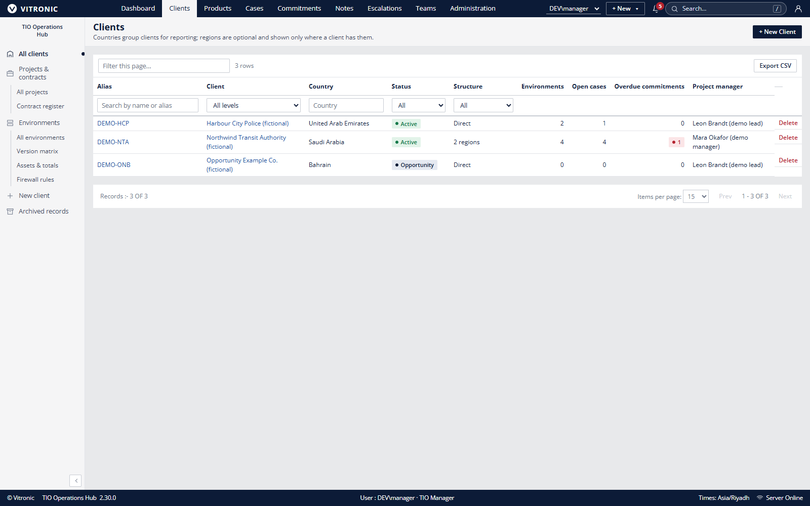
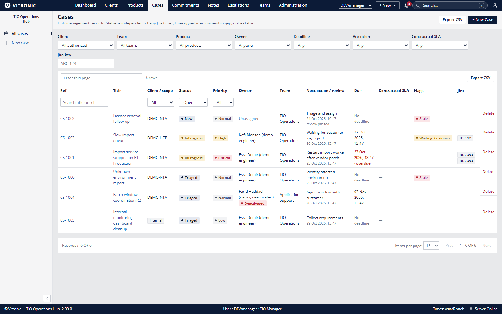
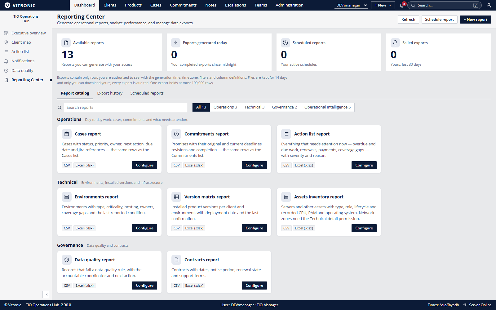

# TIO Hub Product Screenshot Gallery

| Control field | Controlled value |
|---|---|
| Document ID | TIO-DOC-002 |
| Version / status | 2.0 / Illustrative product record |
| Classification | Internal; external use requires brand and product approval |
| Owner / approver | Product owner (proposed) / Brand owner before external use |
| Capture date / review | 24 October 2026 / Refresh after material UI release |
| Capture baseline | Local TIO Hub 2.30.0 development build using fictional demo seed and isolated database |
| Supersedes | Initial screenshot gallery dated 24 October 2026 |

## Capture provenance and limitations

The images below are direct UI captures from a locally run TIO Hub build. The application used fictional development records in a dedicated development database. They are not customer records, production evidence, user research, performance telemetry or product acceptance proof. Displayed counts are snapshots of that local seed and role configuration.

The interface includes the reference VITRONIC wordmark. Obtain the brand owner's approval before external distribution, or replace the capture with an approved brand-safe image. Confirm the target release and user role before using a screenshot as training material. Names, fields, values, menus and report availability may differ by deployment and permission.

## Dashboard

*Fictional development snapshot. KPI cards show record counts and status summaries, not customer outcomes or service guarantees.*

## Client register

*All displayed organizations and records are fictional. Visible columns depend on the user's access.*

## Case register

*References and case details are fictional. The list illustrates current UI fields, not process performance.*

## Reporting Center

*Catalog and available reports vary by release and role. The counts are local demo configuration values.*

## Illustrative record-count chart

*Derived from the same local demo dashboard snapshot. Categories have different meanings and should not be compared as a performance score.*

## Revision history

| Version | Date | Change | Approval |
|---|---|---|---|
| 1.0 | 24 Oct 2026 | Initial screenshot gallery | Draft |
| 2.0 | 24 Oct 2026 | Added provenance, classification, limits and controlled screenshot use | Product/Brand approval pending |
